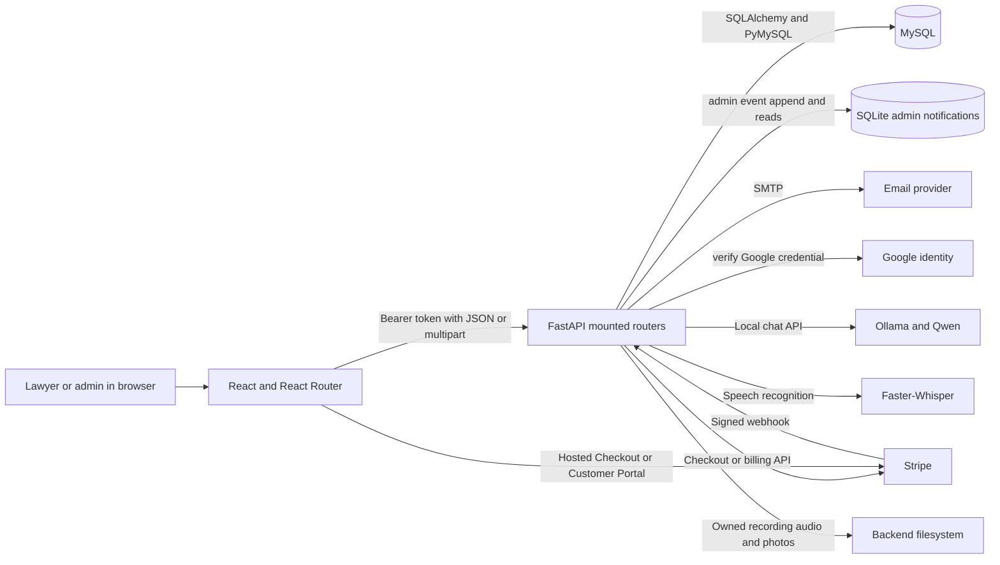

# 01 · Project architecture

AdvocaNote is a legal practice workspace for Sri Lankan lawyers. Its React client renders the public site, lawyer workspace, and staff console. Its FastAPI server owns account verification, access checks, legal records, subscription state, and outside integrations. This guide describes the local source under `D:/AdvocaNote`. It distinguishes source behavior, previously verified Test Mode records, and work that would require a live exercise.

## Read the source in this order

1. Start with [frontend bootstrap](../../advocanote-frontend/src/main.jsx) and [React routes](../../advocanote-frontend/src/App.jsx). Follow one page into its request helper.
2. Open [FastAPI startup](../../advocanote-backend/app/main.py#L76), find the mounted router, then follow its dependencies and SQLAlchemy statements.
3. Find the mapped table in [the database chapter](04_DATABASE_AND_RELATIONSHIPS.md). Read the matching migration to see which constraints were actually declared there.
4. Reconstruct the feature from the [workflow chapter](08_FEATURE_WORKFLOWS.md). For cross-file discovery, use the [file study index](09_FILE_BY_FILE_STUDY_PLAN.md).

## System boundaries

React Router selects client pages; FastAPI selects HTTP operations separately. The client never opens a MySQL connection or decides that Stripe was paid. The database stores domain rows and foreign keys; external billing state and renewal dates originate in Stripe. The lawyer notifications read from MySQL reminders, while admin notifications have their own SQLite store.

## Runtime and integration boundaries

| Boundary | Inspect | What an examiner should hear |
|---|---|---|
| Browser | [main.jsx](../../advocanote-frontend/src/main.jsx), [App.jsx](../../advocanote-frontend/src/App.jsx), [package.json](../../advocanote-frontend/package.json) | Vite builds the React bundle. URL routing, local state, forms, and fetch calls run in the browser. |
| API server | [main.py](../../advocanote-backend/app/main.py), [config.py](../../advocanote-backend/app/config.py), [requirements.txt](../../advocanote-backend/requirements.txt) | Startup wires routers, CORS and scheduled checks. Settings values are external to source. |
| Persistence | [database.py](../../advocanote-backend/app/database.py), [Alembic env](../../advocanote-backend/migrations/env.py) | A session is a unit of work. Model definitions and applied migrations are different layers. |
| AI and media | [legal_ai.py](../../advocanote-backend/app/services/legal_ai.py), [voice_ai.py](../../advocanote-backend/app/routers/voice_ai.py), [voice_storage.py](../../advocanote-backend/app/routers/voice_storage.py) | Transcription, analysis, and saving the resulting artifacts are separate operations. |
| Billing | [lawyer_subscriptions.py](../../advocanote-backend/app/routers/lawyer_subscriptions.py), [subscription_experience.py](../../advocanote-backend/app/routers/subscription_experience.py), [stripe_webhooks.py](../../advocanote-backend/app/routers/stripe_webhooks.py) | Stripe defines the billed contract and MySQL tracks application privileges and history. |

## Verification boundary

The documentation was assembled from local source and source-derived inventories. Earlier billing audits used local read-only MySQL and Stripe Test Mode lookups plus mocks; those findings are labeled separately in chapter 06. No new authentication, email, AI inference, recording, payment, migration, or deployment exercise was run for this documentation. A route found in a file is not necessarily mounted. Runtime deployment values, live schema drift, service health, and credential validity are outside source-only verification.

Next: [Frontend](02_FRONTEND_COMPLETE_GUIDE.md).

## Chapter map

- [FRONTEND COMPLETE GUIDE](02_FRONTEND_COMPLETE_GUIDE.md)
- [BACKEND COMPLETE GUIDE](03_BACKEND_COMPLETE_GUIDE.md)
- [DATABASE AND RELATIONSHIPS](04_DATABASE_AND_RELATIONSHIPS.md)
- [AI AND VOICE](05_AI_AND_VOICE.md)
- [SUBSCRIPTIONS AND PAYMENTS](06_SUBSCRIPTIONS_AND_PAYMENTS.md)
- [SECURITY AND AUTHENTICATION](07_SECURITY_AND_AUTHENTICATION.md)
- [FEATURE WORKFLOWS](08_FEATURE_WORKFLOWS.md)
- [FILE BY FILE STUDY PLAN](09_FILE_BY_FILE_STUDY_PLAN.md)
- [TECHNICAL VIVA QA](10_TECHNICAL_VIVA_QA.md)
