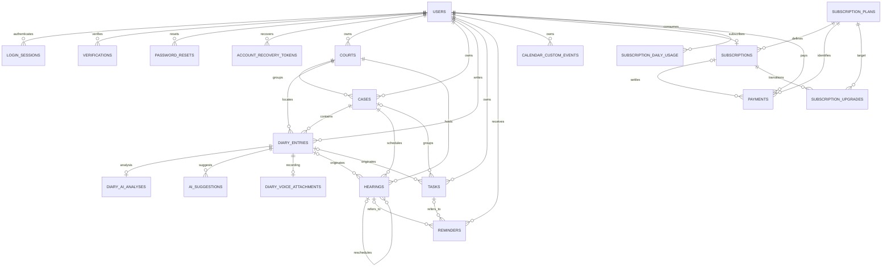

# 04 · Database and relationships

This is a source-derived schema guide. [SQLAlchemy Base and sessions](../../advocanote-backend/app/database.py) are separate from [Alembic’s execution environment](../../advocanote-backend/migrations/env.py). MySQL constraints must exist in the deployed schema to be enforced; a model declaration by itself does not apply DDL. Do not read a model’s existence as proof of an applied migration.

## ERD of the mapped relationships

Arrows describe mapped relationships; an application-level reference is not automatically an FK. See exact nullability and constraints in each table’s source field inventory. The custom-event reminder reference is reconciled by the application. Account deletion records and SQLite admin notifications are documented below as separate records. The ERD includes the recovery token user foreign key.

## How writes and deletions work

- Authentication inserts a User then creates/revokes sessions. Verification/reset records are created and consumed by the corresponding services. User-owned session/token FKs that explicitly use CASCADE are shown in the inventory; account closure uses service logic, so it must be studied separately from hard delete.
- Cases and courts group diary entries. Diary saves can create hearings, tasks, reminders, analyses and suggestions. Case deletion checks for dependent content; diary deletion explicitly handles dependent rows/files where implemented. Review `delete_diary_entry` and the migration definitions before assuming a cascade.
- Calendar reads aggregate events and permits owned custom event CRUD. Its reminders may be reconciled later by the notification router. Lawyer notifications track read/unread state on MySQL reminders.
- A lawyer has at most one local subscription row by unique `user_id`. Plan rows have current Stripe prices, while legacy prices resolve to the same IDs in code. Payment IDs are unique for provider identifiers where declared. Payments preserve per-transaction amounts, and pending payments can exist before they are attached to a local subscription. The quota counter has a composite user/date uniqueness rule.
- Admin notifications are separate SQLite records managed by [admin_notifications_api.py](../../advocanote-backend/admin_notifications_api.py#L30). Its DDL declares ID, type, title, message, serialized details, creation time and read state. It does not establish MySQL foreign keys. Audio and profile file bodies live on disk; MySQL holds metadata and references as implemented.

## Migration reading tips

Order by `revision` and `down_revision`, not by filenames. Revisions include the auth tables, core legal diary, fields for case/hearing/task/onboarding changes, subscription plans/subscriptions/payments and hosted upgrade tracking. Some names repeat because later revisions alter the same area. Startup also has explicit DDL for reminders and the mapped analysis table. Tables that are present in models but have no matching creation in the inspected revision files may require a different setup/history. Applying migrations or starting the app to discover this would exceed the study task.

## SQLAlchemy field inventory

Declarations preserve types, keys, nullability, indexes and FK options where explicit. USER_FK resolves to users.id. Model fields and migration operations are distinct evidence.

### account_deletions

Model: [AccountDeletion](../../advocanote-backend/app/models/account_deletion.py#L14). Account closure audit and identity fields. Account closing/rejoin code reads/writes this area.

| Field | SQLAlchemy declaration |
|---|---|
| [id](../../advocanote-backend/app/models/account_deletion.py#L17) | `mapped_column(Integer, primary_key=True, autoincrement=True)` |
| [original_user_id](../../advocanote-backend/app/models/account_deletion.py#L23) | `mapped_column(Integer, unique=True, nullable=False, index=True)` |
| [status](../../advocanote-backend/app/models/account_deletion.py#L30) | `mapped_column(String(30), nullable=False, default='pending_purge')` |
| [requested_at](../../advocanote-backend/app/models/account_deletion.py#L36) | `mapped_column(DateTime, nullable=False, default=utc_now)` |

Related query or constructor sites, first per file: [account](../../advocanote-backend/app/routers/account.py#L149), [admin_lawyers](../../advocanote-backend/app/routers/admin_lawyers.py#L90).

### account_recovery_tokens

Model: [AccountRecoveryToken](../../advocanote-backend/app/models/account_recovery_token.py#L21). Account rejoin verification tokens. Recovery issues, invalidates or consumes them.

| Field | SQLAlchemy declaration |
|---|---|
| [id](../../advocanote-backend/app/models/account_recovery_token.py#L24) | `Column(Integer, primary_key=True, autoincrement=True)` |
| [user_id](../../advocanote-backend/app/models/account_recovery_token.py#L30) | `Column(Integer, ForeignKey('users.id', ondelete='CASCADE'), nullable=False, index=True)` |
| [token_hash](../../advocanote-backend/app/models/account_recovery_token.py#L42) | `Column(String(64), unique=True, nullable=False, index=True)` |
| [created_at](../../advocanote-backend/app/models/account_recovery_token.py#L49) | `Column(DateTime, nullable=False, default=utc_now)` |
| [expires_at](../../advocanote-backend/app/models/account_recovery_token.py#L55) | `Column(DateTime, nullable=False)` |
| [used_at](../../advocanote-backend/app/models/account_recovery_token.py#L60) | `Column(DateTime, nullable=True)` |

Related query or constructor sites, first per file: [account](../../advocanote-backend/app/routers/account.py#L135).

### ai_suggestions

Model: [AISuggestion](../../advocanote-backend/app/models/aisuggestion.py#L16). Candidate tasks for an entry. Entry save can create these; review can create a Task.

| Field | SQLAlchemy declaration |
|---|---|
| [id](../../advocanote-backend/app/models/aisuggestion.py#L19) | `Column(Integer, primary_key=True, index=True)` |
| [diary_entry_id](../../advocanote-backend/app/models/aisuggestion.py#L25) | `Column(Integer, ForeignKey('diary_entries.id'), nullable=True)` |
| [suggestion_type](../../advocanote-backend/app/models/aisuggestion.py#L31) | `Column(String(30), nullable=False)` |
| [suggested_value](../../advocanote-backend/app/models/aisuggestion.py#L35) | `Column(Text, nullable=False)` |
| [status](../../advocanote-backend/app/models/aisuggestion.py#L39) | `Column(String(20), nullable=False)` |
| [created_at](../../advocanote-backend/app/models/aisuggestion.py#L43) | `Column(DateTime, default=datetime.utcnow, nullable=False)` |

Related query or constructor sites, first per file: [diary](../../advocanote-backend/app/routers/diary.py#L597).

### calendar_custom_events

Model: [CalendarCustomEvent](../../advocanote-backend/app/models/calendar_custom_event.py#L15). Manual calendar events. Calendar routes own CRUD; notifications can reconcile related reminders.

| Field | SQLAlchemy declaration |
|---|---|
| [id](../../advocanote-backend/app/models/calendar_custom_event.py#L18) | `Column(Integer, primary_key=True, index=True)` |
| [lawyer_id](../../advocanote-backend/app/models/calendar_custom_event.py#L24) | `Column(Integer, ForeignKey('users.id'), nullable=False, index=True)` |
| [title](../../advocanote-backend/app/models/calendar_custom_event.py#L31) | `Column(String(120), nullable=False)` |
| [event_date](../../advocanote-backend/app/models/calendar_custom_event.py#L36) | `Column(Date, nullable=False, index=True)` |
| [event_time](../../advocanote-backend/app/models/calendar_custom_event.py#L42) | `Column(Time, nullable=True)` |
| [kind](../../advocanote-backend/app/models/calendar_custom_event.py#L47) | `Column(String(32), nullable=False, default='Meeting')` |
| [notes](../../advocanote-backend/app/models/calendar_custom_event.py#L53) | `Column(Text, nullable=False, default='')` |

Related query or constructor sites, first per file: [calendar](../../advocanote-backend/app/routers/calendar.py#L161), [notifications](../../advocanote-backend/app/routers/notifications.py#L88).

### cases

Model: [Case](../../advocanote-backend/app/models/case.py#L16). Lawyer case identity and court link. Case and diary paths read or create; case deletion checks dependents.

| Field | SQLAlchemy declaration |
|---|---|
| [id](../../advocanote-backend/app/models/case.py#L19) | `Column(Integer, primary_key=True, index=True)` |
| [lawyer_id](../../advocanote-backend/app/models/case.py#L21) | `Column(Integer, ForeignKey(USER_FK), nullable=False, index=True)` |
| [court_id](../../advocanote-backend/app/models/case.py#L26) | `Column(Integer, ForeignKey('courts.id'), nullable=False)` |
| [case_number](../../advocanote-backend/app/models/case.py#L31) | `Column(String(100), nullable=False)` |
| [case_title](../../advocanote-backend/app/models/case.py#L35) | `Column(String(200), nullable=False, default='Untitled Case')` |
| [case_type](../../advocanote-backend/app/models/case.py#L42) | `Column(String(100), nullable=True)` |
| [case_stage](../../advocanote-backend/app/models/case.py#L47) | `Column(String(100), nullable=True)` |
| [status](../../advocanote-backend/app/models/case.py#L51) | `Column(String(30), default='Active', nullable=False)` |
| [created_at](../../advocanote-backend/app/models/case.py#L57) | `Column(DateTime, default=datetime.utcnow, nullable=False)` |

Related query or constructor sites, first per file: [cases](../../advocanote-backend/app/routers/cases.py#L76), [diary](../../advocanote-backend/app/routers/diary.py#L74), [notifications](../../advocanote-backend/app/routers/notifications.py#L217), [tasks](../../advocanote-backend/app/routers/tasks.py#L82).

### courts

Model: [Court](../../advocanote-backend/app/models/court.py#L16). Lawyer-owned court records referenced from case, diary and hearing data.

| Field | SQLAlchemy declaration |
|---|---|
| [id](../../advocanote-backend/app/models/court.py#L19) | `Column(Integer, primary_key=True, index=True)` |
| [court_name](../../advocanote-backend/app/models/court.py#L20) | `Column(String(150), nullable=False)` |
| [location](../../advocanote-backend/app/models/court.py#L21) | `Column(String(150), nullable=False)` |
| [court_type](../../advocanote-backend/app/models/court.py#L22) | `Column(String(100), nullable=True)` |
| [created_by](../../advocanote-backend/app/models/court.py#L23) | `Column(Integer, ForeignKey(USER_FK), nullable=False)` |
| [created_at](../../advocanote-backend/app/models/court.py#L26) | `Column(DateTime, default=datetime.utcnow, nullable=False)` |

Related query or constructor sites, first per file: [cases](../../advocanote-backend/app/routers/cases.py#L83), [diary](../../advocanote-backend/app/routers/diary.py#L75).

### diary_entries

Model: [DiaryEntry](../../advocanote-backend/app/models/diary.py#L16). Primary diary data. Diary routes create, read, edit and delete entries.

| Field | SQLAlchemy declaration |
|---|---|
| [id](../../advocanote-backend/app/models/diary.py#L19) | `Column(Integer, primary_key=True, index=True)` |
| [lawyer_id](../../advocanote-backend/app/models/diary.py#L20) | `Column(Integer, ForeignKey(USER_FK), nullable=False, index=True)` |
| [case_id](../../advocanote-backend/app/models/diary.py#L24) | `Column(Integer, ForeignKey('cases.id'), nullable=False)` |
| [court_id](../../advocanote-backend/app/models/diary.py#L27) | `Column(Integer, ForeignKey('courts.id'), nullable=False)` |
| [entry_date](../../advocanote-backend/app/models/diary.py#L32) | `Column(Date, nullable=False, index=True)` |
| [previous_date](../../advocanote-backend/app/models/diary.py#L34) | `Column(Date, nullable=True)` |
| [step_type](../../advocanote-backend/app/models/diary.py#L35) | `Column(String(40), default='Other', nullable=False)` |
| [step_notes](../../advocanote-backend/app/models/diary.py#L40) | `Column(Text, nullable=False)` |
| [point_notes](../../advocanote-backend/app/models/diary.py#L43) | `Column(Text, nullable=True)` |
| [input_method](../../advocanote-backend/app/models/diary.py#L45) | `Column(String(10), default='manual', nullable=False)` |
| [next_date](../../advocanote-backend/app/models/diary.py#L48) | `Column(Date, nullable=True)` |
| [created_at](../../advocanote-backend/app/models/diary.py#L50) | `Column(DateTime, default=datetime.utcnow, nullable=False)` |
| [updated_at](../../advocanote-backend/app/models/diary.py#L53) | `Column(DateTime, default=datetime.utcnow, onupdate=datetime.utcnow, nullable=False)` |

Related query or constructor sites, first per file: [calendar](../../advocanote-backend/app/routers/calendar.py#L79), [cases](../../advocanote-backend/app/routers/cases.py#L366), [diary](../../advocanote-backend/app/routers/diary.py#L137).

### diary_ai_analyses

Model: [DiaryAIAnalysis](../../advocanote-backend/app/models/diary.py#L59). Saved structured AI output attached to an entry. Diary writes and reads it; startup registers its table.

| Field | SQLAlchemy declaration |
|---|---|
| [diary_entry_id](../../advocanote-backend/app/models/diary.py#L62) | `Column(Integer, ForeignKey('diary_entries.id', ondelete='CASCADE'), primary_key=True)` |
| [notes_json](../../advocanote-backend/app/models/diary.py#L68) | `Column(Text, nullable=False)` |
| [highlights_json](../../advocanote-backend/app/models/diary.py#L69) | `Column(Text, nullable=False)` |
| [output_language](../../advocanote-backend/app/models/diary.py#L71) | `Column(String(2), nullable=False, default='ta')` |
| [analysis_incomplete](../../advocanote-backend/app/models/diary.py#L77) | `Column(Boolean, nullable=False, default=False)` |
| [created_at](../../advocanote-backend/app/models/diary.py#L83) | `Column(DateTime, default=datetime.utcnow, nullable=False)` |

Related query or constructor sites, first per file: [diary](../../advocanote-backend/app/routers/diary.py#L78).

### hearings

Model: [Hearing](../../advocanote-backend/app/models/hearing.py#L16). Hearing dates, state and reschedule links. Diary may insert; hearings routes reschedule or complete.

| Field | SQLAlchemy declaration |
|---|---|
| [id](../../advocanote-backend/app/models/hearing.py#L19) | `Column(Integer, primary_key=True, index=True)` |
| [case_id](../../advocanote-backend/app/models/hearing.py#L21) | `Column(Integer, ForeignKey('cases.id'), nullable=False)` |
| [court_id](../../advocanote-backend/app/models/hearing.py#L27) | `Column(Integer, ForeignKey('courts.id'), nullable=False)` |
| [diary_entry_id](../../advocanote-backend/app/models/hearing.py#L35) | `Column(Integer, ForeignKey('diary_entries.id'), nullable=True)` |
| [hearing_date](../../advocanote-backend/app/models/hearing.py#L41) | `Column(Date, nullable=False, index=True)` |
| [hearing_time](../../advocanote-backend/app/models/hearing.py#L45) | `Column(Time, nullable=True)` |
| [status](../../advocanote-backend/app/models/hearing.py#L50) | `Column(String(30), default='Scheduled', nullable=False)` |
| [reschedule_reason](../../advocanote-backend/app/models/hearing.py#L57) | `Column(Text, nullable=True)` |
| [rescheduled_from_id](../../advocanote-backend/app/models/hearing.py#L64) | `Column(Integer, ForeignKey('hearings.id'), nullable=True)` |
| [created_at](../../advocanote-backend/app/models/hearing.py#L70) | `Column(DateTime, default=datetime.utcnow, nullable=False)` |
| [purpose](../../advocanote-backend/app/models/hearing.py#L76) | `Column(String(255), nullable=True)` |

Related query or constructor sites, first per file: [calendar](../../advocanote-backend/app/routers/calendar.py#L49), [cases](../../advocanote-backend/app/routers/cases.py#L372), [diary](../../advocanote-backend/app/routers/diary.py#L426), [hearings](../../advocanote-backend/app/routers/hearings.py#L55), [notifications](../../advocanote-backend/app/routers/notifications.py#L209).

### payments

Model: [Payment](../../advocanote-backend/app/models/payment.py#L21). Pending/paid/failed/expired transactions. Checkout and webhooks write; lawyer and admin views read.

| Field | SQLAlchemy declaration |
|---|---|
| [id](../../advocanote-backend/app/models/payment.py#L25) | `mapped_column(Integer, primary_key=True, autoincrement=True)` |
| [user_id](../../advocanote-backend/app/models/payment.py#L31) | `mapped_column(Integer, ForeignKey('users.id', ondelete='RESTRICT'), nullable=False)` |
| [subscription_id](../../advocanote-backend/app/models/payment.py#L37) | `mapped_column(Integer, ForeignKey('subscriptions.id', ondelete='RESTRICT'), nullable=True)` |
| [plan_id](../../advocanote-backend/app/models/payment.py#L46) | `mapped_column(Integer, ForeignKey('subscription_plans.id', ondelete='RESTRICT'), nullable=False)` |
| [amount](../../advocanote-backend/app/models/payment.py#L55) | `mapped_column(Numeric(10, 2), nullable=False)` |
| [currency](../../advocanote-backend/app/models/payment.py#L60) | `mapped_column(String(3), nullable=False, server_default=text("'LKR'"))` |
| [provider](../../advocanote-backend/app/models/payment.py#L66) | `mapped_column(String(30), nullable=False, server_default=text("'stripe'"))` |
| [status](../../advocanote-backend/app/models/payment.py#L72) | `mapped_column(String(30), nullable=False, server_default=text("'pending'"))` |
| [stripe_checkout_session_id](../../advocanote-backend/app/models/payment.py#L78) | `mapped_column(String(255), unique=True, nullable=True)` |
| [stripe_payment_intent_id](../../advocanote-backend/app/models/payment.py#L84) | `mapped_column(String(255), unique=True, nullable=True)` |
| [stripe_invoice_id](../../advocanote-backend/app/models/payment.py#L90) | `mapped_column(String(255), unique=True, nullable=True)` |
| [created_at](../../advocanote-backend/app/models/payment.py#L96) | `mapped_column(DateTime, nullable=False, server_default=func.now())` |
| [paid_at](../../advocanote-backend/app/models/payment.py#L102) | `mapped_column(DateTime, nullable=True)` |

Related query or constructor sites, first per file: [admin_subscriptions](../../advocanote-backend/app/routers/admin_subscriptions.py#L592), [lawyer_subscriptions](../../advocanote-backend/app/routers/lawyer_subscriptions.py#L566), [stripe_webhooks](../../advocanote-backend/app/routers/stripe_webhooks.py#L183).

### subscription_upgrades

Model: [SubscriptionUpgrade](../../advocanote-backend/app/models/payment.py#L107). Durable hosted replacement and source retirement tracking. Checkout and recovery change stages.

| Field | SQLAlchemy declaration |
|---|---|
| [id](../../advocanote-backend/app/models/payment.py#L110) | `mapped_column(Integer, primary_key=True, autoincrement=True)` |
| [subscription_id](../../advocanote-backend/app/models/payment.py#L111) | `mapped_column(ForeignKey('subscriptions.id'), nullable=False, index=True)` |
| [target_plan_id](../../advocanote-backend/app/models/payment.py#L114) | `mapped_column(ForeignKey('subscription_plans.id'), nullable=False)` |
| [source_stripe_subscription_id](../../advocanote-backend/app/models/payment.py#L117) | `mapped_column(String(255), unique=True, nullable=False)` |
| [source_period_end](../../advocanote-backend/app/models/payment.py#L120) | `mapped_column(BigInteger, nullable=False)` |
| [attempt_key](../../advocanote-backend/app/models/payment.py#L121) | `mapped_column(String(36), unique=True, nullable=False)` |
| [stripe_checkout_session_id](../../advocanote-backend/app/models/payment.py#L122) | `mapped_column(String(255), unique=True)` |
| [replacement_stripe_subscription_id](../../advocanote-backend/app/models/payment.py#L125) | `mapped_column(String(255), unique=True)` |
| [expires_at](../../advocanote-backend/app/models/payment.py#L128) | `mapped_column(BigInteger, nullable=False)` |
| [status](../../advocanote-backend/app/models/payment.py#L129) | `mapped_column(String(20), nullable=False, index=True)` |

Related query or constructor sites, first per file: [lawyer_subscriptions](../../advocanote-backend/app/routers/lawyer_subscriptions.py#L965), [stripe_webhooks](../../advocanote-backend/app/routers/stripe_webhooks.py#L64), [subscription_experience](../../advocanote-backend/app/routers/subscription_experience.py#L388).

### reminders

Model: [Reminder](../../advocanote-backend/app/models/reminder.py#L22). Lawyer notifications, source references and read state. Domain routes and reminder reconciliation write rows.

| Field | SQLAlchemy declaration |
|---|---|
| [id](../../advocanote-backend/app/models/reminder.py#L25) | `Column(Integer, primary_key=True, index=True)` |
| [user_id](../../advocanote-backend/app/models/reminder.py#L31) | `Column(Integer, ForeignKey(USER_FK), nullable=False, index=True)` |
| [hearing_id](../../advocanote-backend/app/models/reminder.py#L38) | `Column(Integer, ForeignKey('hearings.id'), nullable=True)` |
| [task_id](../../advocanote-backend/app/models/reminder.py#L44) | `Column(Integer, ForeignKey('tasks.id'), nullable=True)` |
| [reminder_type](../../advocanote-backend/app/models/reminder.py#L50) | `Column(String(20), nullable=False)` |
| [title](../../advocanote-backend/app/models/reminder.py#L55) | `Column(String(255), nullable=False)` |
| [reminder_date](../../advocanote-backend/app/models/reminder.py#L60) | `Column(Date, nullable=False)` |
| [is_sent](../../advocanote-backend/app/models/reminder.py#L66) | `Column(Boolean, default=False, nullable=False)` |
| [is_read](../../advocanote-backend/app/models/reminder.py#L73) | `Column(Boolean, default=False, server_default=text('0'), nullable=False)` |
| [read_at](../../advocanote-backend/app/models/reminder.py#L81) | `Column(DateTime, nullable=True)` |
| [created_at](../../advocanote-backend/app/models/reminder.py#L86) | `Column(DateTime, default=datetime.utcnow, nullable=False)` |
| [custom_event_id](../../advocanote-backend/app/models/reminder.py#L92) | `Column(Integer, nullable=True, index=True)` |

Related query or constructor sites, first per file: [calendar](../../advocanote-backend/app/routers/calendar.py#L134), [diary](../../advocanote-backend/app/routers/diary.py#L178), [hearings](../../advocanote-backend/app/routers/hearings.py#L228), [notifications](../../advocanote-backend/app/routers/notifications.py#L96), [tasks](../../advocanote-backend/app/routers/tasks.py#L124).

### password_resets

Model: [PasswordReset](../../advocanote-backend/app/models/reset.py#L17). Password reset records. Link and OTP services use their reset paths for issue, validation and consumption.

| Field | SQLAlchemy declaration |
|---|---|
| [id](../../advocanote-backend/app/models/reset.py#L21) | `mapped_column(Integer, primary_key=True, autoincrement=True)` |
| [user_id](../../advocanote-backend/app/models/reset.py#L27) | `mapped_column(ForeignKey('users.id', ondelete='CASCADE'), nullable=False, index=True)` |
| [token_hash](../../advocanote-backend/app/models/reset.py#L33) | `mapped_column(String(64), unique=True, nullable=False)` |
| [expires_at](../../advocanote-backend/app/models/reset.py#L39) | `mapped_column(DateTime, nullable=False)` |
| [used_at](../../advocanote-backend/app/models/reset.py#L44) | `mapped_column(DateTime, nullable=True)` |
| [created_at](../../advocanote-backend/app/models/reset.py#L49) | `mapped_column(DateTime, server_default=func.now(), nullable=False)` |

Related query or constructor sites, first per file: [otp_recovery](../../advocanote-backend/app/routers/otp_recovery.py#L180), [reset](../../advocanote-backend/app/services/reset.py#L55).

### login_sessions

Model: [LoginSession](../../advocanote-backend/app/models/session.py#L17). Refresh token hash, expiry and revocation. Auth creates, rotates and revokes; the JWT guard reads it.

| Field | SQLAlchemy declaration |
|---|---|
| [id](../../advocanote-backend/app/models/session.py#L21) | `mapped_column(Integer, primary_key=True, autoincrement=True)` |
| [user_id](../../advocanote-backend/app/models/session.py#L27) | `mapped_column(ForeignKey('users.id', ondelete='CASCADE'), nullable=False, index=True)` |
| [token_hash](../../advocanote-backend/app/models/session.py#L33) | `mapped_column(String(64), unique=True, nullable=False)` |
| [expires_at](../../advocanote-backend/app/models/session.py#L39) | `mapped_column(DateTime, nullable=False)` |
| [revoked_at](../../advocanote-backend/app/models/session.py#L44) | `mapped_column(DateTime, nullable=True)` |
| [created_at](../../advocanote-backend/app/models/session.py#L49) | `mapped_column(DateTime, server_default=func.now(), nullable=False)` |

Related query or constructor sites, first per file: [security](../../advocanote-backend/app/auth/security.py#L82), [account](../../advocanote-backend/app/routers/account.py#L121), [auth](../../advocanote-backend/app/services/auth.py#L144), [reset](../../advocanote-backend/app/services/reset.py#L150).

### subscriptions

Model: [Subscription](../../advocanote-backend/app/models/subscription.py#L20). One current state per lawyer. Trial, paid fulfillment, renewal and cancellation paths write status and dates.

| Field | SQLAlchemy declaration |
|---|---|
| [id](../../advocanote-backend/app/models/subscription.py#L31) | `mapped_column(Integer, primary_key=True, autoincrement=True)` |
| [user_id](../../advocanote-backend/app/models/subscription.py#L37) | `mapped_column(Integer, ForeignKey('users.id', ondelete='RESTRICT'), nullable=False)` |
| [plan_id](../../advocanote-backend/app/models/subscription.py#L43) | `mapped_column(Integer, ForeignKey('subscription_plans.id', ondelete='RESTRICT'), nullable=False)` |
| [status](../../advocanote-backend/app/models/subscription.py#L52) | `mapped_column(String(20), nullable=False, server_default=text("'pending'"))` |
| [trial_ends_at](../../advocanote-backend/app/models/subscription.py#L58) | `mapped_column(DateTime, nullable=True)` |
| [started_at](../../advocanote-backend/app/models/subscription.py#L63) | `mapped_column(DateTime, nullable=True)` |
| [current_period_start](../../advocanote-backend/app/models/subscription.py#L68) | `mapped_column(DateTime, nullable=True)` |
| [current_period_end](../../advocanote-backend/app/models/subscription.py#L73) | `mapped_column(DateTime, nullable=True)` |
| [cancel_at_period_end](../../advocanote-backend/app/models/subscription.py#L78) | `mapped_column(Boolean, nullable=False, server_default=text('0'))` |
| [stripe_customer_id](../../advocanote-backend/app/models/subscription.py#L84) | `mapped_column(String(255), nullable=True)` |
| [stripe_subscription_id](../../advocanote-backend/app/models/subscription.py#L89) | `mapped_column(String(255), unique=True, nullable=True)` |
| [created_at](../../advocanote-backend/app/models/subscription.py#L95) | `mapped_column(DateTime, nullable=False, server_default=func.now())` |

Table constraints: `(UniqueConstraint('user_id', name='uq_subscriptions_user_id'),)`.

Related query or constructor sites, first per file: [subscription_guard](../../advocanote-backend/app/auth/subscription_guard.py#L91), [account](../../advocanote-backend/app/routers/account.py#L271), [admin_subscriptions](../../advocanote-backend/app/routers/admin_subscriptions.py#L218), [lawyer_subscriptions](../../advocanote-backend/app/routers/lawyer_subscriptions.py#L324), [stripe_webhooks](../../advocanote-backend/app/routers/stripe_webhooks.py#L58), [subscription_experience](../../advocanote-backend/app/routers/subscription_experience.py#L94), [subscription_trial](../../advocanote-backend/app/services/subscription_trial.py#L150), [subscription_usage](../../advocanote-backend/app/services/subscription_usage.py#L52).

### subscription_daily_usage

Model: [SubscriptionDailyUsage](../../advocanote-backend/app/models/subscription_daily_usage.py#L27). One counter per Colombo user/day. Diary write increments and access response reads.

| Field | SQLAlchemy declaration |
|---|---|
| [id](../../advocanote-backend/app/models/subscription_daily_usage.py#L49) | `mapped_column(Integer, primary_key=True, autoincrement=True)` |
| [user_id](../../advocanote-backend/app/models/subscription_daily_usage.py#L59) | `mapped_column(Integer, ForeignKey('users.id', ondelete='CASCADE'), nullable=False, index=True)` |
| [usage_date](../../advocanote-backend/app/models/subscription_daily_usage.py#L73) | `mapped_column(Date, nullable=False)` |
| [actions_used](../../advocanote-backend/app/models/subscription_daily_usage.py#L82) | `mapped_column(Integer, nullable=False, default=0, server_default=text('0'))` |
| [created_at](../../advocanote-backend/app/models/subscription_daily_usage.py#L93) | `mapped_column(DateTime, nullable=False, server_default=func.now())` |
| [updated_at](../../advocanote-backend/app/models/subscription_daily_usage.py#L103) | `mapped_column(DateTime, nullable=False, server_default=func.now(), onupdate=func.now())` |

Table constraints: `(UniqueConstraint('user_id', 'usage_date', name='uq_subscription_daily_usage_user_day'), CheckConstraint('actions_used >= 0', name='ck_subscription_daily_usage_nonnegative'))`.

Related query or constructor sites, first per file: [subscription_experience](../../advocanote-backend/app/routers/subscription_experience.py#L278), [subscription_usage](../../advocanote-backend/app/services/subscription_usage.py#L197).

### subscription_plans

Model: [SubscriptionPlan](../../advocanote-backend/app/models/subscription_plan.py#L20). Plan rates, intervals, quotas and Stripe identifiers. Admin manages; checkout and access flows read.

| Field | SQLAlchemy declaration |
|---|---|
| [id](../../advocanote-backend/app/models/subscription_plan.py#L23) | `mapped_column(Integer, primary_key=True, autoincrement=True)` |
| [name](../../advocanote-backend/app/models/subscription_plan.py#L29) | `mapped_column(String(100), nullable=False)` |
| [description](../../advocanote-backend/app/models/subscription_plan.py#L34) | `mapped_column(String(500), nullable=True)` |
| [price](../../advocanote-backend/app/models/subscription_plan.py#L39) | `mapped_column(Numeric(10, 2), nullable=False)` |
| [currency](../../advocanote-backend/app/models/subscription_plan.py#L44) | `mapped_column(String(3), nullable=False, server_default=text("'LKR'"))` |
| [billing_interval](../../advocanote-backend/app/models/subscription_plan.py#L50) | `mapped_column(String(20), nullable=False)` |
| [features](../../advocanote-backend/app/models/subscription_plan.py#L55) | `mapped_column(JSON, nullable=False, default=list)` |
| [trial_days](../../advocanote-backend/app/models/subscription_plan.py#L61) | `mapped_column(Integer, nullable=False, server_default=text('0'))` |
| [daily_action_limit](../../advocanote-backend/app/models/subscription_plan.py#L78) | `mapped_column(Integer, nullable=True)` |
| [is_active](../../advocanote-backend/app/models/subscription_plan.py#L83) | `mapped_column(Boolean, nullable=False, server_default=text('1'))` |
| [stripe_product_id](../../advocanote-backend/app/models/subscription_plan.py#L89) | `mapped_column(String(255), nullable=True)` |
| [stripe_price_id](../../advocanote-backend/app/models/subscription_plan.py#L94) | `mapped_column(String(255), unique=True, nullable=True)` |
| [created_at](../../advocanote-backend/app/models/subscription_plan.py#L100) | `mapped_column(DateTime, nullable=False, server_default=func.now())` |

Related query or constructor sites, first per file: [subscription_guard](../../advocanote-backend/app/auth/subscription_guard.py#L122), [admin_subscriptions](../../advocanote-backend/app/routers/admin_subscriptions.py#L71), [lawyer_subscriptions](../../advocanote-backend/app/routers/lawyer_subscriptions.py#L135), [stripe_webhooks](../../advocanote-backend/app/routers/stripe_webhooks.py#L145), [subscription_experience](../../advocanote-backend/app/routers/subscription_experience.py#L124), [subscription_trial](../../advocanote-backend/app/services/subscription_trial.py#L94), [subscription_usage](../../advocanote-backend/app/services/subscription_usage.py#L136).

### tasks

Model: [Task](../../advocanote-backend/app/models/task.py#L16). Lawyer tasks optionally linked to cases or entries. Task routes and approved suggestions write rows.

| Field | SQLAlchemy declaration |
|---|---|
| [id](../../advocanote-backend/app/models/task.py#L19) | `Column(Integer, primary_key=True, index=True)` |
| [lawyer_id](../../advocanote-backend/app/models/task.py#L21) | `Column(Integer, ForeignKey(USER_FK), nullable=False, index=True)` |
| [case_id](../../advocanote-backend/app/models/task.py#L26) | `Column(Integer, ForeignKey('cases.id'), nullable=False)` |
| [diary_entry_id](../../advocanote-backend/app/models/task.py#L32) | `Column(Integer, ForeignKey('diary_entries.id'), nullable=True)` |
| [title](../../advocanote-backend/app/models/task.py#L38) | `Column(String(255), nullable=False)` |
| [deadline](../../advocanote-backend/app/models/task.py#L39) | `Column(Date, nullable=True)` |
| [priority](../../advocanote-backend/app/models/task.py#L41) | `Column(String(15), default='Medium', nullable=False)` |
| [status](../../advocanote-backend/app/models/task.py#L47) | `Column(String(20), default='Pending', nullable=False)` |
| [created_at](../../advocanote-backend/app/models/task.py#L53) | `Column(DateTime, default=datetime.utcnow, nullable=False)` |

Related query or constructor sites, first per file: [calendar](../../advocanote-backend/app/routers/calendar.py#L106), [cases](../../advocanote-backend/app/routers/cases.py#L378), [diary](../../advocanote-backend/app/routers/diary.py#L542), [notifications](../../advocanote-backend/app/routers/notifications.py#L256), [tasks](../../advocanote-backend/app/routers/tasks.py#L103).

### users

Model: [User](../../advocanote-backend/app/models/user.py#L19). Lawyer/admin identities and profile. Auth, onboarding, profile and account services create or update rows; guards read them.

| Field | SQLAlchemy declaration |
|---|---|
| [id](../../advocanote-backend/app/models/user.py#L23) | `mapped_column(Integer, primary_key=True, autoincrement=True)` |
| [full_name](../../advocanote-backend/app/models/user.py#L29) | `mapped_column(String(150), nullable=False)` |
| [email](../../advocanote-backend/app/models/user.py#L34) | `mapped_column(String(254), unique=True, index=True, nullable=False)` |
| [password_hash](../../advocanote-backend/app/models/user.py#L41) | `mapped_column(String(255), nullable=True)` |
| [google_sub](../../advocanote-backend/app/models/user.py#L46) | `mapped_column(String(255), unique=True, nullable=True)` |
| [role](../../advocanote-backend/app/models/user.py#L52) | `mapped_column(String(20), nullable=False, server_default=text("'lawyer'"))` |
| [is_email_verified](../../advocanote-backend/app/models/user.py#L58) | `mapped_column(Boolean, nullable=False, server_default=text('0'))` |
| [is_active](../../advocanote-backend/app/models/user.py#L64) | `mapped_column(Boolean, nullable=False, server_default=text('1'))` |
| [created_at](../../advocanote-backend/app/models/user.py#L70) | `mapped_column(DateTime, nullable=False, server_default=func.now())` |
| [onboarding_status](../../advocanote-backend/app/models/user.py#L81) | `mapped_column(String(20), nullable=False, server_default=text("'pending'"))` |
| [phone_number](../../advocanote-backend/app/models/user.py#L91) | `mapped_column(String(30), nullable=True)` |
| [city](../../advocanote-backend/app/models/user.py#L96) | `mapped_column(String(100), nullable=True)` |
| [bar_number](../../advocanote-backend/app/models/user.py#L101) | `mapped_column(String(100), nullable=True)` |
| [practice_areas](../../advocanote-backend/app/models/user.py#L106) | `mapped_column(JSON, nullable=True)` |
| [preferred_language](../../advocanote-backend/app/models/user.py#L111) | `mapped_column(String(20), nullable=False, server_default=text("'English'"))` |
| [hearing_reminders](../../advocanote-backend/app/models/user.py#L121) | `mapped_column(Boolean, nullable=False, server_default=text('1'))` |
| [task_reminders](../../advocanote-backend/app/models/user.py#L127) | `mapped_column(Boolean, nullable=False, server_default=text('1'))` |
| [email_notifications](../../advocanote-backend/app/models/user.py#L133) | `mapped_column(Boolean, nullable=False, server_default=text('1'))` |
| [professional_title](../../advocanote-backend/app/models/user.py#L139) | `mapped_column(String(80), nullable=True)` |
| [law_firm](../../advocanote-backend/app/models/user.py#L144) | `mapped_column(String(150), nullable=True)` |

Related query or constructor sites, first per file: [security](../../advocanote-backend/app/auth/security.py#L94), [account](../../advocanote-backend/app/routers/account.py#L255), [admin_lawyers](../../advocanote-backend/app/routers/admin_lawyers.py#L71), [admin_settings](../../advocanote-backend/app/routers/admin_settings.py#L132), [admin_subscriptions](../../advocanote-backend/app/routers/admin_subscriptions.py#L574), [auth](../../advocanote-backend/app/routers/auth.py#L82), [lawyer_subscriptions](../../advocanote-backend/app/routers/lawyer_subscriptions.py#L391), [stripe_webhooks](../../advocanote-backend/app/routers/stripe_webhooks.py#L467), [auth](../../advocanote-backend/app/services/auth.py#L26), [google](../../advocanote-backend/app/services/google.py#L92), [onboarding_service](../../advocanote-backend/app/services/onboarding_service.py#L52), [reset](../../advocanote-backend/app/services/reset.py#L43), [subscription_trial](../../advocanote-backend/app/services/subscription_trial.py#L129), [subscription_usage](../../advocanote-backend/app/services/subscription_usage.py#L103), [verification](../../advocanote-backend/app/services/verification.py#L120).

### verifications

Model: [Verification](../../advocanote-backend/app/models/verification.py#L17). Email verification tokens and lifetime. Verification service creates and consumes them.

| Field | SQLAlchemy declaration |
|---|---|
| [id](../../advocanote-backend/app/models/verification.py#L21) | `mapped_column(Integer, primary_key=True, autoincrement=True)` |
| [user_id](../../advocanote-backend/app/models/verification.py#L27) | `mapped_column(ForeignKey('users.id', ondelete='CASCADE'), nullable=False, index=True)` |
| [token_hash](../../advocanote-backend/app/models/verification.py#L33) | `mapped_column(String(64), unique=True, nullable=False)` |
| [expires_at](../../advocanote-backend/app/models/verification.py#L39) | `mapped_column(DateTime, nullable=False)` |
| [created_at](../../advocanote-backend/app/models/verification.py#L44) | `mapped_column(DateTime, server_default=func.now(), nullable=False)` |

Related query or constructor sites, first per file: [verification](../../advocanote-backend/app/services/verification.py#L30).

### diary_voice_attachments

Model: [DiaryVoiceAttachment](../../advocanote-backend/app/models/voice_attachment.py#L16). Audio keys, metadata, both transcripts and AI fields. Voice storage writes and reads; diary deletion can clean up.

| Field | SQLAlchemy declaration |
|---|---|
| [id](../../advocanote-backend/app/models/voice_attachment.py#L19) | `Column(Integer, primary_key=True, index=True)` |
| [diary_entry_id](../../advocanote-backend/app/models/voice_attachment.py#L25) | `Column(Integer, ForeignKey('diary_entries.id', ondelete='CASCADE'), unique=True, nullable=False, index=True)` |
| [lawyer_id](../../advocanote-backend/app/models/voice_attachment.py#L36) | `Column(Integer, nullable=False, index=True)` |
| [file_key](../../advocanote-backend/app/models/voice_attachment.py#L42) | `Column(String(100), nullable=False)` |
| [original_filename](../../advocanote-backend/app/models/voice_attachment.py#L47) | `Column(String(255), nullable=False)` |
| [mime_type](../../advocanote-backend/app/models/voice_attachment.py#L52) | `Column(String(120), nullable=False)` |
| [size_bytes](../../advocanote-backend/app/models/voice_attachment.py#L57) | `Column(Integer, nullable=False)` |
| [source_transcript](../../advocanote-backend/app/models/voice_attachment.py#L62) | `Column(Text, nullable=False)` |
| [reviewed_transcript](../../advocanote-backend/app/models/voice_attachment.py#L67) | `Column(Text, nullable=False)` |
| [ai_notes_json](../../advocanote-backend/app/models/voice_attachment.py#L72) | `Column(Text, nullable=False, default='[]')` |
| [highlights_json](../../advocanote-backend/app/models/voice_attachment.py#L78) | `Column(Text, nullable=False, default='[]')` |
| [approved_notes_json](../../advocanote-backend/app/models/voice_attachment.py#L84) | `Column(Text, nullable=False, default='[]')` |
| [created_at](../../advocanote-backend/app/models/voice_attachment.py#L90) | `Column(DateTime, default=datetime.utcnow, nullable=False)` |
| [updated_at](../../advocanote-backend/app/models/voice_attachment.py#L96) | `Column(DateTime, default=datetime.utcnow, onupdate=datetime.utcnow, nullable=False)` |

Related query or constructor sites, first per file: [voice_storage](../../advocanote-backend/app/routers/voice_storage.py#L345).

## Alembic revisions

| Revision | Parent | Source | Upgrade operations |
|---|---|---|---|
| `2ce42a642a99` | `None` | [advocanote-backend/migrations/versions/2ce42a642a99_create_users_table.py](../../advocanote-backend/migrations/versions/2ce42a642a99_create_users_table.py) | [create_table users](../../advocanote-backend/migrations/versions/2ce42a642a99_create_users_table.py#L24), [create_index](../../advocanote-backend/migrations/versions/2ce42a642a99_create_users_table.py#L37), [f ix_users_email](../../advocanote-backend/migrations/versions/2ce42a642a99_create_users_table.py#L37) |
| `3624a224a6d1` | `e3e8e3a14c3a` | [advocanote-backend/migrations/versions/3624a224a6d1_add_lawyer_onboarding_profile.py](../../advocanote-backend/migrations/versions/3624a224a6d1_add_lawyer_onboarding_profile.py) | [add_column users](../../advocanote-backend/migrations/versions/3624a224a6d1_add_lawyer_onboarding_profile.py#L25), [add_column users](../../advocanote-backend/migrations/versions/3624a224a6d1_add_lawyer_onboarding_profile.py#L35), [add_column users](../../advocanote-backend/migrations/versions/3624a224a6d1_add_lawyer_onboarding_profile.py#L40), [add_column users](../../advocanote-backend/migrations/versions/3624a224a6d1_add_lawyer_onboarding_profile.py#L45), [add_column users](../../advocanote-backend/migrations/versions/3624a224a6d1_add_lawyer_onboarding_profile.py#L50), [add_column users](../../advocanote-backend/migrations/versions/3624a224a6d1_add_lawyer_onboarding_profile.py#L55), [add_column users](../../advocanote-backend/migrations/versions/3624a224a6d1_add_lawyer_onboarding_profile.py#L65), [add_column users](../../advocanote-backend/migrations/versions/3624a224a6d1_add_lawyer_onboarding_profile.py#L75), [add_column users](../../advocanote-backend/migrations/versions/3624a224a6d1_add_lawyer_onboarding_profile.py#L85), [alter_column users](../../advocanote-backend/migrations/versions/3624a224a6d1_add_lawyer_onboarding_profile.py#L96) |
| `38aee0ee9923` | `7024b90b2279` | [advocanote-backend/migrations/versions/38aee0ee9923_create_payments_table.py](../../advocanote-backend/migrations/versions/38aee0ee9923_create_payments_table.py) | [create_table payments](../../advocanote-backend/migrations/versions/38aee0ee9923_create_payments_table.py#L24) |
| `3a7ec36244b3` | `44c054ddbe95` | [advocanote-backend/migrations/versions/3a7ec36244b3_create_password_resets_table.py](../../advocanote-backend/migrations/versions/3a7ec36244b3_create_password_resets_table.py) | [create_table password_resets](../../advocanote-backend/migrations/versions/3a7ec36244b3_create_password_resets_table.py#L24), [create_index](../../advocanote-backend/migrations/versions/3a7ec36244b3_create_password_resets_table.py#L35), [f ix_password_resets_user_id](../../advocanote-backend/migrations/versions/3a7ec36244b3_create_password_resets_table.py#L35) |
| `4138f2f6e75f` | `c28bc937b3dd` | [advocanote-backend/migrations/versions/4138f2f6e75f_allow_manual_tasks.py](../../advocanote-backend/migrations/versions/4138f2f6e75f_allow_manual_tasks.py) | [alter_column tasks](../../advocanote-backend/migrations/versions/4138f2f6e75f_allow_manual_tasks.py#L22) |
| `44c054ddbe95` | `7d93423a65df` | [advocanote-backend/migrations/versions/44c054ddbe95_create_login_sessions_table.py](../../advocanote-backend/migrations/versions/44c054ddbe95_create_login_sessions_table.py) | [create_table login_sessions](../../advocanote-backend/migrations/versions/44c054ddbe95_create_login_sessions_table.py#L24), [create_index](../../advocanote-backend/migrations/versions/44c054ddbe95_create_login_sessions_table.py#L35), [f ix_login_sessions_user_id](../../advocanote-backend/migrations/versions/44c054ddbe95_create_login_sessions_table.py#L35) |
| `4501bae7bce5` | `60abde51d92e` | [advocanote-backend/migrations/versions/4501bae7bce5_add_hearing_purpose.py](../../advocanote-backend/migrations/versions/4501bae7bce5_add_hearing_purpose.py) | No static match. |
| `60abde51d92e` | `c5ba33c8d092` | [advocanote-backend/migrations/versions/60abde51d92e_add_hearing_reschedule_fields.py](../../advocanote-backend/migrations/versions/60abde51d92e_add_hearing_reschedule_fields.py) | [get_bind](../../advocanote-backend/migrations/versions/60abde51d92e_add_hearing_reschedule_fields.py#L35), [add_column hearings](../../advocanote-backend/migrations/versions/60abde51d92e_add_hearing_reschedule_fields.py#L47), [add_column hearings](../../advocanote-backend/migrations/versions/60abde51d92e_add_hearing_reschedule_fields.py#L59), [alter_column hearings](../../advocanote-backend/migrations/versions/60abde51d92e_add_hearing_reschedule_fields.py#L72), [create_foreign_key fk_hearings_rescheduled_from_id](../../advocanote-backend/migrations/versions/60abde51d92e_add_hearing_reschedule_fields.py#L97) |
| `7024b90b2279` | `e4188767de73` | [advocanote-backend/migrations/versions/7024b90b2279_create_lawyer_subscriptions.py](../../advocanote-backend/migrations/versions/7024b90b2279_create_lawyer_subscriptions.py) | [create_table subscriptions](../../advocanote-backend/migrations/versions/7024b90b2279_create_lawyer_subscriptions.py#L24) |
| `7d93423a65df` | `2ce42a642a99` | [advocanote-backend/migrations/versions/7d93423a65df_create_verifications_table.py](../../advocanote-backend/migrations/versions/7d93423a65df_create_verifications_table.py) | [create_table verifications](../../advocanote-backend/migrations/versions/7d93423a65df_create_verifications_table.py#L24), [create_index](../../advocanote-backend/migrations/versions/7d93423a65df_create_verifications_table.py#L34), [f ix_verifications_user_id](../../advocanote-backend/migrations/versions/7d93423a65df_create_verifications_table.py#L34) |
| `9d9dd1fe79b9` | `3a7ec36244b3` | [advocanote-backend/migrations/versions/9d9dd1fe79b9_add_legal_diary_tables.py](../../advocanote-backend/migrations/versions/9d9dd1fe79b9_add_legal_diary_tables.py) | [create_table courts](../../advocanote-backend/migrations/versions/9d9dd1fe79b9_add_legal_diary_tables.py#L24), [create_index](../../advocanote-backend/migrations/versions/9d9dd1fe79b9_add_legal_diary_tables.py#L34), [f ix_courts_id](../../advocanote-backend/migrations/versions/9d9dd1fe79b9_add_legal_diary_tables.py#L34), [create_table cases](../../advocanote-backend/migrations/versions/9d9dd1fe79b9_add_legal_diary_tables.py#L35), [create_index](../../advocanote-backend/migrations/versions/9d9dd1fe79b9_add_legal_diary_tables.py#L47), [f ix_cases_id](../../advocanote-backend/migrations/versions/9d9dd1fe79b9_add_legal_diary_tables.py#L47), [create_index](../../advocanote-backend/migrations/versions/9d9dd1fe79b9_add_legal_diary_tables.py#L48), [f ix_cases_lawyer_id](../../advocanote-backend/migrations/versions/9d9dd1fe79b9_add_legal_diary_tables.py#L48), [create_table diary_entries](../../advocanote-backend/migrations/versions/9d9dd1fe79b9_add_legal_diary_tables.py#L49), [create_index](../../advocanote-backend/migrations/versions/9d9dd1fe79b9_add_legal_diary_tables.py#L68), [f ix_diary_entries_entry_date](../../advocanote-backend/migrations/versions/9d9dd1fe79b9_add_legal_diary_tables.py#L68), [create_index](../../advocanote-backend/migrations/versions/9d9dd1fe79b9_add_legal_diary_tables.py#L69), [f ix_diary_entries_id](../../advocanote-backend/migrations/versions/9d9dd1fe79b9_add_legal_diary_tables.py#L69), [create_index](../../advocanote-backend/migrations/versions/9d9dd1fe79b9_add_legal_diary_tables.py#L70), [f ix_diary_entries_lawyer_id](../../advocanote-backend/migrations/versions/9d9dd1fe79b9_add_legal_diary_tables.py#L70), [create_table ai_suggestions](../../advocanote-backend/migrations/versions/9d9dd1fe79b9_add_legal_diary_tables.py#L71), [create_index](../../advocanote-backend/migrations/versions/9d9dd1fe79b9_add_legal_diary_tables.py#L81), [f ix_ai_suggestions_id](../../advocanote-backend/migrations/versions/9d9dd1fe79b9_add_legal_diary_tables.py#L81), [create_table hearings](../../advocanote-backend/migrations/versions/9d9dd1fe79b9_add_legal_diary_tables.py#L82), [create_index](../../advocanote-backend/migrations/versions/9d9dd1fe79b9_add_legal_diary_tables.py#L96), [f ix_hearings_hearing_date](../../advocanote-backend/migrations/versions/9d9dd1fe79b9_add_legal_diary_tables.py#L96), [create_index](../../advocanote-backend/migrations/versions/9d9dd1fe79b9_add_legal_diary_tables.py#L97), [f ix_hearings_id](../../advocanote-backend/migrations/versions/9d9dd1fe79b9_add_legal_diary_tables.py#L97), [create_table tasks](../../advocanote-backend/migrations/versions/9d9dd1fe79b9_add_legal_diary_tables.py#L98), [create_index](../../advocanote-backend/migrations/versions/9d9dd1fe79b9_add_legal_diary_tables.py#L113), [f ix_tasks_id](../../advocanote-backend/migrations/versions/9d9dd1fe79b9_add_legal_diary_tables.py#L113), [create_index](../../advocanote-backend/migrations/versions/9d9dd1fe79b9_add_legal_diary_tables.py#L114), [f ix_tasks_lawyer_id](../../advocanote-backend/migrations/versions/9d9dd1fe79b9_add_legal_diary_tables.py#L114), [create_table reminders](../../advocanote-backend/migrations/versions/9d9dd1fe79b9_add_legal_diary_tables.py#L115), [create_index](../../advocanote-backend/migrations/versions/9d9dd1fe79b9_add_legal_diary_tables.py#L130), [f ix_reminders_id](../../advocanote-backend/migrations/versions/9d9dd1fe79b9_add_legal_diary_tables.py#L130), [create_index](../../advocanote-backend/migrations/versions/9d9dd1fe79b9_add_legal_diary_tables.py#L131), [f ix_reminders_user_id](../../advocanote-backend/migrations/versions/9d9dd1fe79b9_add_legal_diary_tables.py#L131) |
| `9e57dd0418e7` | `ead393f05b53` | [advocanote-backend/migrations/versions/9e57dd0418e7_add_lawyer_professional_profile_fields.py](../../advocanote-backend/migrations/versions/9e57dd0418e7_add_lawyer_professional_profile_fields.py) | [add_column users](../../advocanote-backend/migrations/versions/9e57dd0418e7_add_lawyer_professional_profile_fields.py#L23), [add_column users](../../advocanote-backend/migrations/versions/9e57dd0418e7_add_lawyer_professional_profile_fields.py#L32) |
| `c28bc937b3dd` | `9d9dd1fe79b9` | [advocanote-backend/migrations/versions/c28bc937b3dd_add_case_type_and_case_stage.py](../../advocanote-backend/migrations/versions/c28bc937b3dd_add_case_type_and_case_stage.py) | [add_column hearings](../../advocanote-backend/migrations/versions/c28bc937b3dd_add_case_type_and_case_stage.py#L23) |
| `c5ba33c8d092` | `4138f2f6e75f` | [advocanote-backend/migrations/versions/c5ba33c8d092_allow_manual_tasks.py](../../advocanote-backend/migrations/versions/c5ba33c8d092_allow_manual_tasks.py) | [alter_column ai_suggestions](../../advocanote-backend/migrations/versions/c5ba33c8d092_allow_manual_tasks.py#L32) |
| `e3e8e3a14c3a` | `4501bae7bce5` | [advocanote-backend/migrations/versions/e3e8e3a14c3a_create_hearing_purpose_column.py](../../advocanote-backend/migrations/versions/e3e8e3a14c3a_create_hearing_purpose_column.py) | [get_bind](../../advocanote-backend/migrations/versions/e3e8e3a14c3a_create_hearing_purpose_column.py#L23), [add_column hearings](../../advocanote-backend/migrations/versions/e3e8e3a14c3a_create_hearing_purpose_column.py#L32) |
| `e4188767de73` | `9e57dd0418e7` | [advocanote-backend/migrations/versions/e4188767de73_create_subscription_plans.py](../../advocanote-backend/migrations/versions/e4188767de73_create_subscription_plans.py) | [create_table subscription_plans](../../advocanote-backend/migrations/versions/e4188767de73_create_subscription_plans.py#L23) |
| `ead393f05b53` | `3624a224a6d1` | [advocanote-backend/migrations/versions/ead393f05b53_add_lawyer_profile_professional_fields.py](../../advocanote-backend/migrations/versions/ead393f05b53_add_lawyer_profile_professional_fields.py) | No static match. |
| `f6f9c4214d30` | `38aee0ee9923` | [advocanote-backend/migrations/versions/f6f9c4214d30_add_subscription_upgrade_attempts.py](../../advocanote-backend/migrations/versions/f6f9c4214d30_add_subscription_upgrade_attempts.py) | [create_table subscription_upgrades](../../advocanote-backend/migrations/versions/f6f9c4214d30_add_subscription_upgrade_attempts.py#L16), [create_index ix_subscription_upgrades_subscription_id](../../advocanote-backend/migrations/versions/f6f9c4214d30_add_subscription_upgrade_attempts.py#L29), [create_index ix_subscription_upgrades_status](../../advocanote-backend/migrations/versions/f6f9c4214d30_add_subscription_upgrade_attempts.py#L30) |

Migration heads in source: `f6f9c4214d30`.
