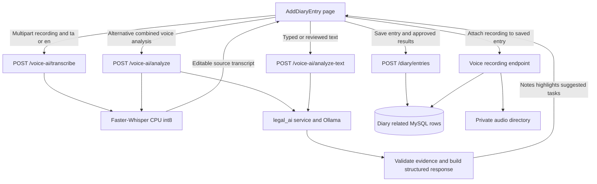

# 05 · AI and voice

## Pipeline overview

## From text to structured output

1. [AddDiaryEntry.jsx](../../advocanote-frontend/src/pages/AddDiaryEntry.jsx) holds the lawyer’s text, voice draft, analysis output and approval state. [voiceAi.js](../../advocanote-frontend/src/services/voiceAi.js) contains request helpers. The live text-analysis endpoint in [voice_ai.py](../../advocanote-backend/app/routers/voice_ai.py#L356) accepts a bounded transcript and language preference. It uses the diary subscription gate but does not itself consume the new-entry quota.
2. [analyze_legal_transcript](../../advocanote-backend/app/services/legal_ai.py#L1246) normalizes the source, selects English/Tamil output automatically or from the request, splits statements and batches them. Statement numbering gives the model an evidence reference within that batch.
3. [ask_qwen](../../advocanote-backend/app/services/legal_ai.py#L1195) uses the Ollama Python client on local port 11434, calling `qwen3.5:0.8b`. It sends a legal-domain system prompt plus language instructions and numbered user statements. The call requests JSON, sets temperature to zero, disables thinking output, and configures context/output limits and keep-alive. Temperature zero is a configuration choice, not proof of correctness.
4. It parses JSON and checks for an object. Helpers such as `valid_ids`, `safe_ai_point`, `source_category`, and `extract_source_tasks` filter references, language, evidence, names/dates and legal relevance, deduplicate results, and use source-derived fallback heuristics. The response fields are `notes`, `critical_highlights`, `suggested_tasks`, `ai_suggested_followups`, `requires_approval`, and `analysis_incomplete`. Followups are currently an empty list in that return path. The UI presents structured notes; the service does not guarantee a free-form abstract for every input.
5. Failed model batches can set `analysis_incomplete` while source-derived extraction continues where applicable. The outer analysis wrapper handles errors, and the lawyer can save text without a successful AI result because the diary payload allows an optional analysis. Fallback and model output still require human review. The current code prints analysis details in some diagnostic paths, so local AI output still has a potential confidentiality footprint. [Batch processing](../../advocanote-backend/app/services/legal_ai.py#L1329)

## From recorded file to transcript

1. The recording upload uses multipart input with Tamil (`ta`) or English (`en`). The backend validates extension and limits uploads to **20 MiB** and transcript text to **20,000 characters**. The transcription helper writes to a temporary file, closes the upload and removes temporary material on exit. [Upload guards](../../advocanote-backend/app/routers/voice_ai.py#L135)
2. [transcribe_audio](../../advocanote-backend/app/routers/voice_ai.py#L97) uses the language-specific Faster-Whisper model from `WHISPER_MODELS`, CPU execution and int8 compute. It consumes the segment iterator and joins text. This is transcription, rather than a guarantee of translation; output-language selection belongs to the analysis layer.
3. The separate combined endpoint transcribes then analyzes. Server failures produce HTTP errors or incomplete analysis as applicable. Microphone permission, supported codecs, model weights availability and first inference latency depend on the target environment. Neither model was invoked for this documentation.
4. Saving the diary entry and saving audio are distinct. [voice_storage.py](../../advocanote-backend/app/routers/voice_storage.py#L198) checks diary ownership, validates multipart and JSON-list fields, writes a generated file key under `private_voice_recordings`, then commits attachment metadata, source and reviewed transcripts, AI notes, highlights and approved notes. An older recording is removed only after the replacement commit. Owned routes return recording details and stream the audio. A diary save succeeding does not prove the later attachment succeeded.
5. [diary.py](../../advocanote-backend/app/routers/diary.py#L376) can store AI analysis in `diary_ai_analyses`; suggestion rows belong to a diary entry. Reviewing a task suggestion is an explicit workflow that can create a Task. The model has no direct database-write tool.

## Study questions

Explain why a syntactically valid JSON object is insufficient. Walk from a model-suggested task back to an evidence ID and then to the lawyer’s approval. Draw separate storage boundaries for an input upload, the editable transcript, the diary analysis row, and the private recording binary. Do not claim Tamil transcription quality, provider availability, legal accuracy or zero hallucinations without an actual evaluation.
