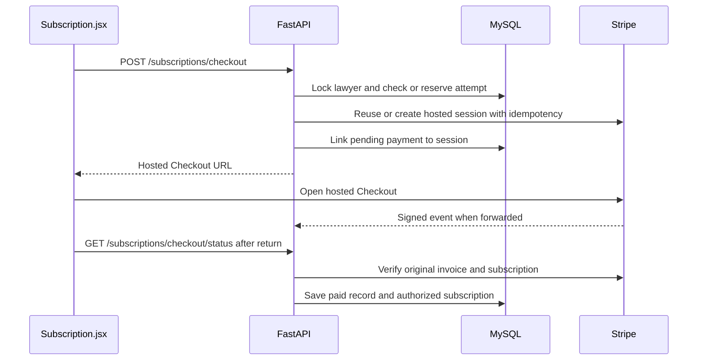

# 06 · Subscriptions and payments

## Catalog and access

| Official plan ID | Purchase rate | Diary usage |
|---|---|---|
| 4 Monthly | LKR 2,490/month | Read the admin-configured cap; last verified local value 3 |
| 5 Premium Monthly | LKR 5,100/month | Uncapped when the field is NULL |
| 3 Annual | LKR 24,900/year | Uncapped when the field is NULL |

The lawyer catalog allows these official IDs. Admin still sees the sandbox plan; existing sandbox subscribers are not removed by that catalog filter. [Trial service](../../advocanote-backend/app/services/subscription_trial.py#L118) creates a one-time local 30-day unlimited trial for an eligible lawyer, usually on dashboard access. It validates the official plan association without comparing the trial to the paid amount or quota. The subscription guard checks status and expiry, and the diary usage service resolves Colombo date and uses a transaction lock. The shared feature guard grants the feature set to a valid plan; Premium and Annual card copy should not be read as exclusivity for AI or voice. [Access](../../advocanote-backend/app/routers/subscription_experience.py#L184) · [Usage](../../advocanote-backend/app/services/subscription_usage.py#L93)

## Ordinary purchase and reconciliation

[create_checkout](../../advocanote-backend/app/routers/lawyer_subscriptions.py#L377) checks official target, locks the lawyer, and reserves a pending payment. The Stripe request uses the durable reservation ID as an idempotency key. An unconfirmed or abandoned session cannot activate a plan; the endpoint reuses a suitable open session or verifies that an older session is no longer payable before opening another. A stored pre-price-change reservation retains its original request parameters. The app persists the link before exposing the hosted URL.

[Initial handling](../../advocanote-backend/app/routers/stripe_webhooks.py#L211) checks the owned payment/session, customer, subscription/plan metadata, the matching Stripe item, active period, and the original Checkout invoice. It records the invoice referenced by Checkout even if the subscription has renewed. Already-paid rows are skipped. The success page asks the server to verify, so redirect URLs are not proof of payment.

## Upgrades, schedules, cancel and renew

- **Hosted upgrade:** `POST /subscriptions/change-plan/preview` previews billing; the lawyer confirms via `/subscriptions/select`. `open_upgrade_checkout` saves an attempt with an idempotency key and source period information, then opens hosted subscription Checkout. `process_checkout_upgrade` verifies ownership, Stripe paid invoice, full amount without proration, replacement item and billing period. MySQL commits the paid replacement and a retirement marker; retirement cancels the source without final invoice/proration and can be retried by the scheduler. A brief overlap is possible. [Checkout orchestration](../../advocanote-backend/app/routers/subscription_experience.py#L386) · [Webhook/retirement](../../advocanote-backend/app/routers/stripe_webhooks.py#L72)
- **Scheduled change:** `POST /subscriptions/change-plan/downgrade` is explicitly Test Mode gated. It preserves the current phase’s Stripe price, places the selected official price in the next phase, and disables proration for the change. Local plan/access moves when the matching paid renewal verifies. [Schedule handler](../../advocanote-backend/app/routers/lawyer_subscriptions.py#L1538)
- **Cancel:** `POST /subscriptions/manage` opens the dedicated Stripe portal. `POST /subscriptions/cancel` can also set period-end cancellation after ownership and conflict checks. The active period remains valid until its end; Stripe cancellation updates/deletion then synchronize local state. Portal plan switching is disabled by configuration validation. [Portal](../../advocanote-backend/app/routers/lawyer_subscriptions.py#L863)
- **Renewal and recovery:** `invoice.paid` for subscription cycle verifies the Stripe invoice and updates local period/plan and the payment record. Failure records status without extending paid dates. Status updates can produce `past_due` or `unpaid`; the UI links to Manage Billing to address the bill. Old Stripe Price IDs remain accepted; the corresponding old amount is used for historical validation. The catalog price alone cannot tell what a grandfathered customer pays. [Renewal](../../advocanote-backend/app/routers/stripe_webhooks.py#L752) · [Legacy price lookup](../../advocanote-backend/app/routers/stripe_webhooks.py#L2198)
- **Admin:** role-protected endpoints manage plans and daily limits and read subscriptions/payments. History stores actual amounts by payment. [Admin subscriptions](../../advocanote-backend/app/routers/admin_subscriptions.py) · [Payment model](../../advocanote-backend/app/models/payment.py)

## Evidence and limitations

Earlier read-only local review found 21 matching paid invoices, 11 30-day trial rows, a completed LKR 14,900 grandfathered Annual upgrade with the source canceled and no pending retirement, and nine of ten linked subscriptions matching after legacy-rate resolution. Isolated unpaid Test Mode Checkout sessions had previously shown the three current catalog amounts and were expired. Mocked regressions covered Checkout concurrency, signed dispatch, initial invoice recovery, old/new rates, upgrades, scheduling, cancellation, and renewals. This documentation run did not repeat those operations.

Known issues from that review and the current source are: Test Clock subscription #3 has a real plan/date mismatch; the current status API can display the catalog rate for a grandfathered customer; first dashboard trial creation can leave an existing repeatable-read snapshot stale; admin can configure a cap on a nominally unlimited tier; admin price linking can call `.get()` on an SDK Price; webhook delivery was not demonstrated at that audit point; the five-second upgrade timing check and retirement retry leave edge-case risks. Real renewal retry, completed checkout at new rates, first-account browser flow and post-cancel expiry still require dedicated end-to-end verification. [Status price](../../advocanote-backend/app/routers/lawyer_subscriptions.py#L235) · [Trial access](../../advocanote-backend/app/routers/subscription_experience.py#L184) · [Admin Stripe linking](../../advocanote-backend/app/routers/admin_subscriptions.py#L430)
