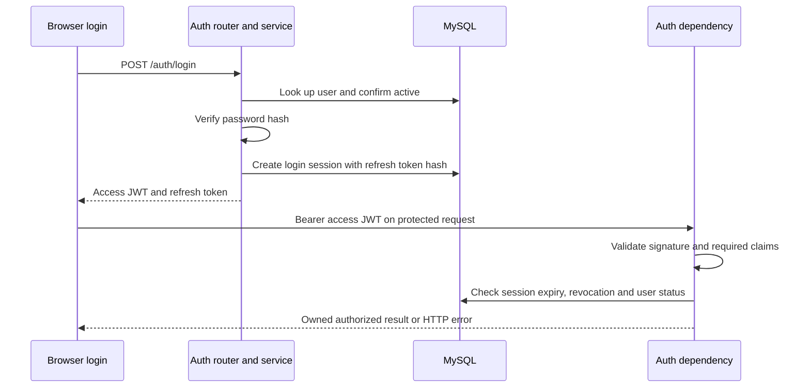

# 07 · Security and authentication

## Login and access

[security.py](../../advocanote-backend/app/auth/security.py#L31) uses PyJWT HS256 and puts user subject, session ID, issued time and expiry into the access JWT. Backend verification requires subject, session and expiry and restricts the algorithm. It loads the session and user, confirms they belong together, and checks session revocation/expiry and active status. A valid JWT string can therefore become unusable if its server session is revoked. Settings default to 15 minutes for access and 7 days for refresh. [Settings](../../advocanote-backend/app/config.py)

[services/auth.py](../../advocanote-backend/app/services/auth.py#L128) uses a cryptographically generated refresh token and persists a SHA-256 digest rather than the token string. The refresh endpoint resolves a valid session and rotates credentials through the service. Logout revokes the server-side session. Password verification uses the configured recommended `pwdlib.PasswordHash` scheme and its verify function. Hashing is one-way verification, unlike encryption. Avoid assuming an algorithm or work factor that the source does not explicitly pin. Token strings live in browser storage in the current client, with implications for script compromise. [Auth service](../../advocanote-backend/app/services/auth.py) · [Browser auth helper](../../advocanote-frontend/src/services/auth.js)

## Registration, verification, recovery and roles

- Registration validates data, stores a lawyer role, active flag and password hash, and checks both an existing email and integrity failures. Registration alone does not activate a paid subscription. Valid password login can still proceed while email verification is pending in the inspected code. [Registration service](../../advocanote-backend/app/services/auth.py#L23)
- Email verification and reset links have distinct services and data. OTP recovery has separate request, verify and reset endpoints with HMAC-backed codes, expiry/attempt handling and constant-time comparison. Inspect each endpoint before describing which credential it accepts. [OTP](../../advocanote-backend/app/routers/otp_recovery.py#L86) · [Verification](../../advocanote-backend/app/services/verification.py) · [Reset](../../advocanote-backend/app/services/reset.py)
- Google sign-in verifies the external credential using the backend Google service and its configured client ID. Account rejoin/closure is a different workflow with its own owner checks, tokens and session revocation. [Google service](../../advocanote-backend/app/services/google.py) · [Account workflow](../../advocanote-backend/app/routers/account.py)
- Admin authorization uses a server-side role guard; lawyer routers also enforce active account status, onboarding, ownership or subscription depending on route. For instance, a valid lawyer with a recorded diary entry still must own it to download its audio. UI guards help navigation but are not authoritative. [Admin guard](../../advocanote-backend/app/auth/admin_guard.py) · [Subscription guard](../../advocanote-backend/app/auth/subscription_guard.py) · [Owned audio](../../advocanote-backend/app/routers/voice_storage.py#L159)

## Validation and practical limitations

| Area | Implemented protection and scope |
|---|---|
| API inputs | Typed FastAPI/Pydantic bodies, enum restrictions and explicit application validation; multipart endpoints validate extension and size. Input validation is not permission checking. |
| SQL | SQLAlchemy expressions build bound-value queries. Text SQL used for startup DDL is a separate path with literal statements. This does not by itself certify every dynamic query or configuration. |
| HTTP statuses | Common examples are 401 invalid session, 403 denied/inactive, 404 missing or non-owned resource as implemented, 409 conflict or pending verification, 422 validation, 429 diary quota, and 502/503 upstream or temporary failure. |
| Stripe | Raw body and `Stripe-Signature` go to `stripe.Webhook.construct_event`; a verified event can still be ignored when the entity does not match an application record. Payment ownership, invoice and period validation are independent checks. |
| Email and logs | SMTP delivery is external. Model diagnostic logs can include legal output. Verify log access and production settings separately. |
| Browser | CORS only covers the actual declared origins and does not authorize a user. Local storage tokens are readable by same-origin scripts. A literal public Google client ID is distinct from backend secret settings. |

No penetration tests, email/OTP delivery, browser token refresh, or deployment security claims are implied by this chapter.
