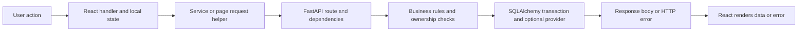
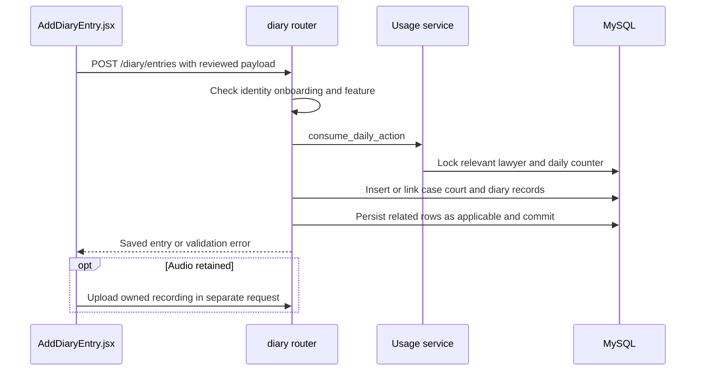

# 08 · Feature workflows

Each flow starts at the rendered action and ends at the data returned or persisted by the mounted backend. Check the endpoint inventory for exact decorator lines and the database chapter for individual fields.

## Identity and profile

| User action | Actual execution path |
|---|---|
| Register | `Register.jsx` validates visible fields → `services/auth.js` posts `/auth/register` → `routers/auth.register` → `services/auth.register_user` checks email, hashes password and inserts `users` → success/error renders. The browser records an onboarding hint; paid billing has no part in registration. |
| Login, Google, and logout | `Login.jsx` → `POST /auth/login` or `POST /auth/google` → password or Google credential check → `login_sessions` and auth tokens → guarded role route. `GET /auth/me` supplies user identity. `POST /auth/refresh` and `/auth/logout` operate on the server session. |
| Reset or rejoin | `ForgotPassword.jsx` and `otpRecovery.js` → OTP request/verify/reset under `/auth/forgot-password`; legacy link endpoints are in `auth.py` and use reset/verification services. `RejoinAccount.jsx` calls `POST /account/recovery/request` and `/complete`, which use account closure/recovery records. No delivery was exercised. |
| Onboard, update profile | `FirstLoginOnboarding.jsx` → `GET /onboarding/me`, `PUT /onboarding/complete` → onboarding service writes profile fields on `users`. `Profile.jsx` → `/profile/me` and `/profile/photo` → ownership checks, profile changes and controlled filesystem photo operations. |

## Legal workspace

| User action | Actual execution path |
|---|---|
| Diary save | `AddDiaryEntry.jsx` → `services/diary.js` or local request helper → `POST /diary/entries` → `diary.create_entry` checks access/quota, verifies or creates case/court references and writes `diary_entries`; related hearings, tasks, reminders, AI analyses and suggestions are conditional on the submitted data. SQLAlchemy flushes for generated IDs and the diary and quota commit together. The client can attach an audio blob separately. [Create handler](../../advocanote-backend/app/routers/diary.py#L224) |
| Diary list/detail/edit/delete | `MyLegalDiary.jsx` loads `GET /diary/overview` and case history as needed. `DiaryEntryDetails.jsx` loads `GET /diary/entries/{entry_id}`, saves edits via PUT and can delete via DELETE. The route enforces record ownership and explicitly manages dependent data as implemented. |
| Cases | `MyCases.jsx` uses `GET/POST /cases`, `PATCH /cases/{case_id}/status` and `DELETE /cases/{case_id}` → `cases.py` → `cases`, related court/diary records and dependency checks before deletion. `CaseDetails.jsx` and `CaseTasks.jsx` are not standalone top-level App routes. |
| Hearings | `Hearings.jsx` → `GET /hearings`, reschedule or complete via `PATCH /hearings/{hearing_id}/reschedule` or `/complete` → `hearings.py` scopes by lawyer/case, changes hearing status and related reminder rows → refreshes the list. |
| Tasks | `TasksPremium.jsx` loads `GET /tasks` and can create with `POST /tasks/case/{case_id}`, edit/complete with `PATCH /tasks/{task_id}` or delete with DELETE. The routes enforce access and write `tasks` and related reminders where applicable. Its filename is not a Premium-only permission. |
| Calendar | `Calendar.jsx` calls `GET /calendar/events`. The router constructs the calendar from owned application records. POST creates a custom event, and PATCH/DELETE at `/calendar/events/{event_id}` update `calendar_custom_events`. |
| Lawyer notifications | `NotificationBell.jsx` and its dropdown call `/notifications` and the read/unread routes. `notifications.py` reconciles applicable custom event reminders and filters visibility. `reminders` hold the notification state; relevant hearing/task updates can affect visibility. |
| AI/voice and suggested tasks | `AddDiaryEntry.jsx` or `voiceAi.js` calls `/voice-ai/transcribe`, `/analyze-text`, or combined `/analyze` as wired. Saved analysis goes through diary persistence. `AISuggestions.jsx` lists `GET /diary/ai-suggestions` and calls PATCH on a suggestion to review or approve. Approved task behavior lives in `review_ai_suggestion`. Owned voice metadata and audio are fetched separately. [Detailed AI flow](05_AI_AND_VOICE.md) |

## Billing and administration

- `SubscriptionGate.jsx` loads `GET /subscriptions/access`, which may create a first trial. `Subscription.jsx` loads `/subscriptions/plans`, `/me`, and `/payments` and posts Checkout, plan change or portal requests. Checkout success polls status. Stripe events independently call `POST /webhooks/stripe`. `subscriptions`, `payments`, `subscription_upgrades` and `subscription_daily_usage` each have separate roles. [Billing state machine](06_SUBSCRIPTIONS_AND_PAYMENTS.md)
- `AdminDashboard.jsx`, `AdminLawyers.jsx`, and `AdminSubscriptions.jsx` read aggregate account/billing records. Admins can change lawyer status through `PATCH /admin/lawyers/{lawyer_id}/status`; plans and daily limits use `/admin/subscriptions/plans`. Admin settings use `/admin/settings/profile` and `/password`. The staff notifications API talks to SQLite, distinct from the lawyer notification APIs backed by MySQL.
- Account closure is requested from the profile flow via `DELETE /account/me`. It coordinates session revocation and account records in `account.py`; inspect the logic for billing and identity conflicts. Do not execute closure during study.
