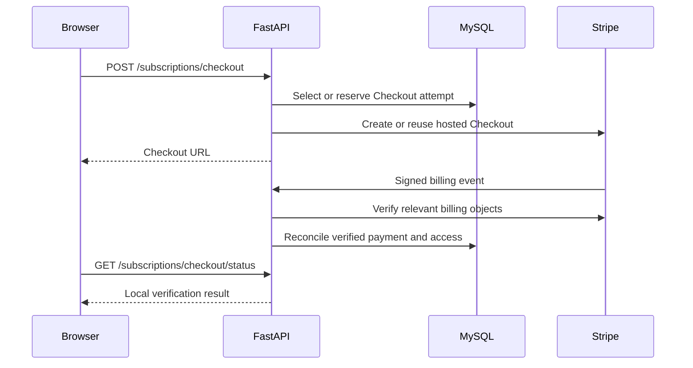

# Hosted registration, billing and media incidents — Full Answers

இவை diagnostic questions. Reported symptoms current live root cause-ஐ நிரூபிக்காது. Code evidence தெரிஞ்ச பகுதிகளையும், hosted logs/data மூலம் verify செய்ய வேண்டிய பகுதிகளையும் answers தெளிவாகச் சொல்கின்றன.

## Two boundaries to trace before debugging

A success redirect, webhook receipt, paid invoice and committed entitlement are four different pieces of evidence.

### QUESTION 053 — Why might a new lawyer register successfully on Railway but never receive a 30-day trial?

**Project scenario P01.**

**COMPLETE ANSWER (English):**

Registration and entitlement are separate success criteria. An authenticated dashboard request may evaluate a one-time trial. Eligibility depends on account state/history and the needed official plan record. A valid database schema does not provide plan rows. A running service can also be using a different database or revision than expected.

**SIMPLE TAMIL-ENGLISH EXPLANATION:**

Account create ஆனது first step. Trial start ஆக user eligible-ஆ, சரியான plan row இருக்கா, dashboard எந்த API-க்கு போகுது என்று தனியா check பண்ணணும்.

**HOW IT WORKS IN ADVOCANOTE:**

GET /subscriptions/access calls subscription_access. Trial eligibility uses start_free_trial_if_eligible, resolves an official plan and computes now + timedelta(days=30). The source shows possible causes. An older incident report is not proof of the current hosted cause.

**ACTUAL CODE CONNECTION:**

- [app/routers/subscription_experience.py, line 183](../../advocanote-backend/app/routers/subscription_experience.py#L183)
- [app/services/subscription_trial.py, line 82](../../advocanote-backend/app/services/subscription_trial.py#L82)
- [app/services/subscription_trial.py, line 118](../../advocanote-backend/app/services/subscription_trial.py#L118)
- [app/services/subscription_trial.py, line 171](../../advocanote-backend/app/services/subscription_trial.py#L171)

**WHY IS IT USED?**

Keep trial granting idempotent. Seed or provision intended catalog records only after verifying target and plan identities. Moving grant logic to registration is a different product/transaction decision.

**POSSIBLE ERRORS AND DEBUGGING:**

Compare the deployed branch and API response, inspect the selected schema and official plan rows read-only, then examine user status and existing history. Caution: subscription access can create a trial. Do not use a real eligible account to run this endpoint during a read-only audit.

**SHORT ANSWER FOR MY TECHNICAL VIVA:**

“Registration proves the account exists, not that subscription access is active. I check the first access request, eligible user history and the official plan record in the database used by Railway. Then I reproduce trial creation and repeated access with a disposable account.”

**FOLLOW-UP QUESTION 1:**

Can the table exist with no catalog data?

**FOLLOW-UP ANSWER 1:**

Yes. Alembic schema and provisioned plan rows are separate.

**FOLLOW-UP QUESTION 2:**

How would you test repeated access?

**FOLLOW-UP ANSWER 2:**

In isolation compare the same subscription ID and expiry after multiple access requests. The first grant should not be renewed by later reads.

---

### QUESTION 054 — Why might the hosted Available Plans section be empty even when local plans display?

**Project scenario P02.**

**COMPLETE ANSWER (English):**

An empty UI can represent a valid empty API list, a request failure, role denial, or a render/filter problem. Distinguish empty records from schema absence and validate the effective frontend API base before comparing code. A local DB and hosted DB commonly have different seeded state.

**SIMPLE TAMIL-ENGLISH EXPLANATION:**

Card காணலன்னா first Network response பார்க்கணும். Empty array வந்ததா, 401 வந்ததா, CORS block ஆனதா, அதுக்கப்புறம் React render fail ஆனதா என்றெல்லாம் பிரிக்கலாம்.

**HOW IT WORKS IN ADVOCANOTE:**

The lawyer plans handler selects official catalog records. React Subscription loads data using the configured backend. An official row that is absent or filtered out cannot create a card. Current production data was not queried for this document.

**ACTUAL CODE CONNECTION:**

- [src/pages/Subscription.jsx, line 251](../../advocanote-frontend/src/pages/Subscription.jsx#L251)
- [app/routers/lawyer_subscriptions.py, line 262](../../advocanote-backend/app/routers/lawyer_subscriptions.py#L262)
- [app/services/subscription_trial.py, line 25](../../advocanote-backend/app/services/subscription_trial.py#L25)

**WHY IS IT USED?**

Use a controlled provisioning procedure with documented official IDs and existing provider references. Frontend should reflect verified catalog outcomes and meaningful errors. Hardcoding replacement paid plans in JSX would create a separate source of truth.

**POSSIBLE ERRORS AND DEBUGGING:**

Capture method, URL, status and sanitized response. Check running builds, MySQL target, migration revision and active plan rows with read-only evidence. Compare API JSON to UI state before proposing a fix.

**SHORT ANSWER FOR MY TECHNICAL VIVA:**

“I start with the actual hosted plans request. If the API returns an empty list, I check official active plan rows in the hosting database. If it returns an error or points to localhost, I investigate auth, CORS or deployment configuration before changing the catalog.”

**FOLLOW-UP QUESTION 1:**

Could successful login prove the plans table is populated?

**FOLLOW-UP ANSWER 1:**

No. Login reads identity/session data, while plans come from a separate catalog query.

**FOLLOW-UP QUESTION 2:**

What does an API 500 with a missing table suggest?

**FOLLOW-UP ANSWER 2:**

Schema or database-target evidence is needed. It differs from an existing table with no eligible rows.

---

### QUESTION 055 — Why can a grandfathered subscriber see a display price that differs from the Stripe renewal amount?

**Project scenario P03.**

**COMPLETE ANSWER (English):**

A plan represents product identity and features. A Stripe Price represents a particular amount, currency and interval attached to a provider subscription. Changing the catalog's new-customer Price does not automatically change an existing subscriber's attached Price. Historical invoices preserve the charged amount.

**SIMPLE TAMIL-ENGLISH EXPLANATION:**

இப்போ plan card காட்டும் rate new users-க்கு. பழைய subscriber old Stripe Price-ல் இருந்தா renewal வேற amount ஆகலாம். Invoice தான் actual payment evidence.

**HOW IT WORKS IN ADVOCANOTE:**

The trial/pricing service accepts recognized historical Price IDs for a plan. The subscription response and catalog are separate from the Stripe subscription item and its invoice. Code inspection is not evidence of a specific account's provider state.

**ACTUAL CODE CONNECTION:**

- [app/services/subscription_trial.py, line 67](../../advocanote-backend/app/services/subscription_trial.py#L67)
- [app/routers/lawyer_subscriptions.py, line 106](../../advocanote-backend/app/routers/lawyer_subscriptions.py#L106)
- [app/routers/lawyer_subscriptions.py, line 831](../../advocanote-backend/app/routers/lawyer_subscriptions.py#L831)

**WHY IS IT USED?**

Separate labels for available plan rate and verified current renewal amount. Preserve historical payment amounts and match versioned Price IDs. Do not mutate someone's subscription just to make the display match.

**POSSIBLE ERRORS AND DEBUGGING:**

In read-only mode compare plan ID, attached Stripe Price ID, interval/currency, current invoice or appropriate read-only Stripe evidence, and stored payment history. Use a legacy Price fixture to test rendered labels.

**SHORT ANSWER FOR MY TECHNICAL VIVA:**

“A plan can keep the same ID while its current catalog rate changes. Existing Stripe subscribers can retain their original Price. I compare the attached Price and verified payment history before treating a display mismatch as incorrect billing.”

**FOLLOW-UP QUESTION 1:**

Why avoid joining payments to today's plan amount for historical totals?

**FOLLOW-UP ANSWER 1:**

Today's amount can differ from the amount actually paid. Use the amount recorded for the payment.

**FOLLOW-UP QUESTION 2:**

Should a legacy Price always be rejected?

**FOLLOW-UP ANSWER 2:**

No. It can be valid for a grandfathered subscription. Validation must use the verified mapping and operation context.

---

### QUESTION 056 — Why can Stripe Checkout succeed without activating the local subscription?

**Project scenario P04.**

**COMPLETE ANSWER (English):**

Checkout navigation and provider financial state are separate from local entitlement. Verified reconciliation must match the customer, owned session, subscription and paid invoice, and commit a local change. A delayed event, intentional skip, or database write failure can leave a legitimate payment unreconciled.

**SIMPLE TAMIL-ENGLISH EXPLANATION:**

Stripe success page பார்த்ததாலே MySQL plan update ஆயிடுச்சு என்று சொல்ல முடியாது. Backend correct invoice மற்றும் user match பண்ணி verify செய்யணும்.

**HOW IT WORKS IN ADVOCANOTE:**

The ordinary checkout status endpoint supports recovery and the webhook handles verified billing events. Initial Checkout processing and ordinary renewal processing are separate. Paid upgrade attempts also have a reconciliation path.

**ACTUAL CODE CONNECTION:**

- [app/routers/lawyer_subscriptions.py, line 948](../../advocanote-backend/app/routers/lawyer_subscriptions.py#L948)
- [app/routers/stripe_webhooks.py, line 211](../../advocanote-backend/app/routers/stripe_webhooks.py#L211)
- [app/routers/stripe_webhooks.py, line 1918](../../advocanote-backend/app/routers/stripe_webhooks.py#L1918)
- [app/routers/subscription_experience.py, line 1142](../../advocanote-backend/app/routers/subscription_experience.py#L1142)

**WHY IS IT USED?**

Use durable attempts and replay-safe reconciliation. Treat a browser redirect as a status signal. Keeping activation server-side avoids granting access based on a client-controlled URL.

**POSSIBLE ERRORS AND DEBUGGING:**

Read the provider object and local attempt/payment state with authorized read-only access. Check delivery status, signature/skip logs, original invoice linkage and commit evidence before retrying. Do not create a second payment as a diagnostic step.

**SHORT ANSWER FOR MY TECHNICAL VIVA:**

“I check whether Stripe actually paid the correct invoice and whether the owned Checkout attempt reconciled in MySQL. The success redirect is not payment proof. If webhook processing was delayed, the existing recovery path should be examined using the same operation identity.”

**FOLLOW-UP QUESTION 1:**

Can HTTP 200 from a webhook mean the handler intentionally skipped an event?

**FOLLOW-UP ANSWER 1:**

Yes. Verify the event type, matching entities, logs and local result.

**FOLLOW-UP QUESTION 2:**

Which first invoice matters after a renewal?

**FOLLOW-UP ANSWER 2:**

The initial Checkout Session's verified invoice, not the subscription's latest invoice.

---

### QUESTION 057 — How would you debug a Stripe webhook that never appears in Railway?

**Project scenario P05.**

**COMPLETE ANSWER (English):**

Delivery, validation, dispatch and persistence are four distinct stages. Stripe must send the event to the correct reachable URL in the correct mode. The API verifies the signature for that endpoint and raw payload. A verified event still needs a handled type and matching application state. Persistence needs its own proof.

**SIMPLE TAMIL-ENGLISH EXPLANATION:**

Stripe event create ஆனது வேற. Railway endpoint-க்கு வந்ததா என்பது வேற. வந்த பிறகு signature valid-ஆ, app process பண்ணிச்சா, DB save ஆச்சா என்று தனியா பார்க்கணும்.

**HOW IT WORKS IN ADVOCANOTE:**

The mounted POST /webhooks/stripe handler reads Stripe-Signature and invokes stripe.Webhook.construct_event with the raw body and configured signing secret. It dispatches supported types to domain handlers. Local CLI and hosted endpoint may have different signing secrets.

**ACTUAL CODE CONNECTION:**

- [app/main.py, line 198](../../advocanote-backend/app/main.py#L198)
- [app/routers/stripe_webhooks.py, line 1998](../../advocanote-backend/app/routers/stripe_webhooks.py#L1998)
- [app/routers/stripe_webhooks.py, line 2022](../../advocanote-backend/app/routers/stripe_webhooks.py#L2022)

**WHY IS IT USED?**

Use durable logging with event IDs/types and safe dispositions. Unbounded or manual replay can hide logic faults; isolated mocked tests can verify individual handler paths without touching live billing.

**POSSIBLE ERRORS AND DEBUGGING:**

Inspect existing Stripe delivery history and Railway logs for the same event ID/time. Confirm exact path, environment mode, status and whether verification was reached. Keep secret values private and avoid sending new live events.

**SHORT ANSWER FOR MY TECHNICAL VIVA:**

“I first ask whether Stripe attempted delivery to the correct Railway URL. Then I check the HTTP status and signature validation, followed by whether the event matched an owned local record and resulted in a commit. I do not treat 200 as proof of a database update.”

**FOLLOW-UP QUESTION 1:**

Why is the raw body used for signature verification?

**FOLLOW-UP ANSWER 1:**

The signature covers the delivered payload bytes. Reserializing JSON can change the bytes.

**FOLLOW-UP QUESTION 2:**

Why might a CLI secret not validate hosted delivery?

**FOLLOW-UP ANSWER 2:**

Local forwarding signs with its own endpoint secret; remote webhook configuration supplies separate signing credentials.

---

### QUESTION 058 — Why might saved recordings disappear after a Railway deployment?

**Project scenario P06.**

**COMPLETE ANSWER (English):**

An application filesystem can be ephemeral. Database references can remain while the bytes they identify vanish or become inaccessible from a new instance. Permanent file storage requires a persistent mount or another durable store and a backup plan that verifies both reference and content.

**SIMPLE TAMIL-ENGLISH EXPLANATION:**

MySQL-ல் filename save ஆயிருந்தாலும் audio file disk-ல். New container-க்கு அந்த disk கிடைக்கலன்னா playback fail ஆகலாம். Database row மட்டும் transfer பண்ணினா audio bytes கிடைக்காது.

**HOW IT WORKS IN ADVOCANOTE:**

Voice storage writes files under a private recording directory and stores attachment metadata. Owned playback resolves from the stored reference. Profile images and the admin SQLite store are further persistence concerns.

**ACTUAL CODE CONNECTION:**

- [app/routers/voice_storage.py, line 52](../../advocanote-backend/app/routers/voice_storage.py#L52)
- [app/routers/voice_storage.py, line 302](../../advocanote-backend/app/routers/voice_storage.py#L302)
- [app/routers/voice_storage.py, line 479](../../advocanote-backend/app/routers/voice_storage.py#L479)
- [app/models/voice_attachment.py](../../advocanote-backend/app/models/voice_attachment.py)

**WHY IS IT USED?**

Mount durable storage at the actual path or use private object storage with owner-checked serving. Back up the database and media consistently enough to preserve reference integrity.

**POSSIBLE ERRORS AND DEBUGGING:**

Read deployment mount metadata and compare configured path with the path used in the code. Check file existence and checksums in authorized storage and ownership/metadata mapping in a restored isolated setup. Do not expose private recordings.

**SHORT ANSWER FOR MY TECHNICAL VIVA:**

“The voice attachment row is metadata; the audio binary lives separately. I'd verify the active Railway mount and actual path, check files against their references, and validate a restore. A MySQL dump alone cannot recover the audio.”

**FOLLOW-UP QUESTION 1:**

Why might one instance play a file while another cannot?

**FOLLOW-UP ANSWER 1:**

They may have different local disks or mount paths. Shared or externally reachable storage is needed for cross-instance access.

**FOLLOW-UP QUESTION 2:**

Can you infer the deployed storage is ephemeral just from this code?

**FOLLOW-UP ANSWER 2:**

No. It shows the application path. Deployment mount and runtime evidence establish persistence.
